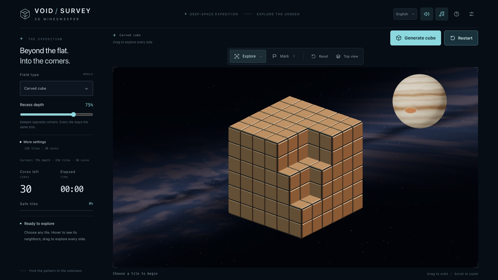

# VOID SURVEY

**English** | [简体中文](README.zh-CN.md)

**[Play now in your browser →](https://stanatny.github.io/minesweeper/)** · No installation or account required

Minesweeper across a carved 3D cube floating in deep space. Explore metal hatches on every face, read numbers across ridges and recessed corners, place energy beacons, and clear the sector — classic rules extended to sharp-edged 3D forms, with a floating planar ruin for the traditional layout.

*Actual screenshot from the live build: the default carved cube (216 tiles, 30 cores) against a procedural solar-system backdrop.*

## Field types

- **Carved cube** (default) — play across an entire closed 3D object; orbit freely through both poles. Adjust recess depth, tile count (96–864) and core density (8–25%).
- **Planar ruin** — the classic rectangular board with Scout / Deep / Frontier presets or custom sizes.

The first reveal is always safe. Numbers count shared-edge and shared-corner neighbors, even across ridges. If WebGL 2 is unavailable, the same board continues in a playable 2D compatibility grid. A procedural Milky Way with ten celestial bodies surrounds the board; victory fireworks and mine chain reactions are synced to locally synthesized audio — no external downloads.

## Controls

| Action | Input |
| --- | --- |
| Reveal | Left-click or tap |
| Flag | Right-click, Mark mode, or long-press |
| Chord | Double-click a matched number |
| Orbit / zoom / pan | Drag · scroll or pinch · two-finger drag |
| Keyboard | Arrows + `Enter` / `Space`, `F` flag, `V` top view, `R` restart |

Interface in English or 中文, remembered per browser.

## Native macOS app

`mac/` contains a classic 2D SwiftUI version (macOS 14+). Download a build from [Releases](https://github.com/stanatny/minesweeper/releases) or build with `./build.sh`.

## Development

Requires Node.js 22+, npm, and Chrome for browser tests: `npm ci && npm run build && npm test`. Build artifacts are checked in, so the page loads without a build step. See the [changelog](changelog.md), [third-party notices](third_party_notices.md), and the [MIT license](LICENSE).
