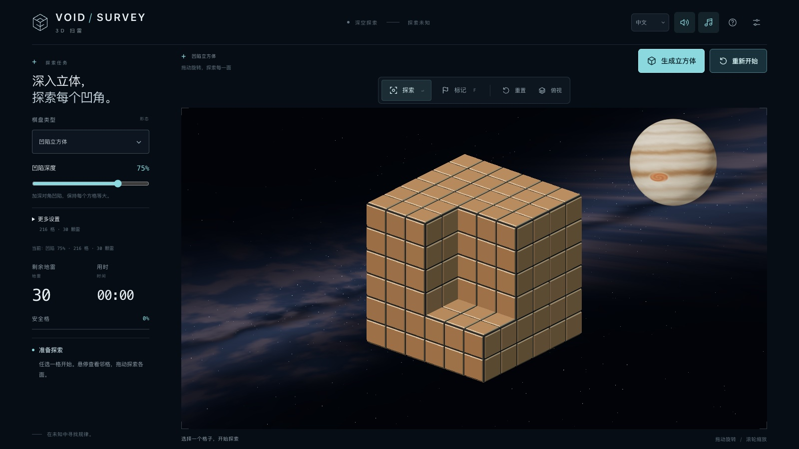

# VOID SURVEY · 3D 扫雷

**English** | [简体中文](README.zh-CN.md)

**[立即在浏览器试玩 →](https://stanatny.github.io/minesweeper/)** · 无需安装、无需注册

在深空中一座雕刻立方体的每个面上玩扫雷。探索金属舱门，跨过棱脊与凹陷读取数字，放置能量信标，清空整个区域——经典规则延伸到棱角分明的 3D 立体上；也可选择浮空平面遗迹，回到传统布局。

*在线版本的实机截图（中文界面）：默认凹陷立方体，216 格 · 30 枚地雷，背景为程序生成的太阳系。*

## 棋盘类型

- **凹陷立方体**（默认）——在完整封闭的 3D 立体上对局，可绕两极自由旋转。可调凹陷深度、格子数（96–864）与地雷密度（8–25%）。
- **平面遗迹**——经典矩形棋盘，提供侦察 / 深探 / 边疆三档预设与自定义尺寸。

首次翻开永远安全。数字按共边与共角邻居计算，跨棱脊同样成立。若 WebGL 2 不可用，同一棋盘会自动切换为可玩的 2D 兼容网格。棋盘四周环绕银河与十大天体；通关烟花与地雷连锁爆炸均与本地合成音效同步——无需下载任何外部资源。

## 操作

| 动作 | 输入 |
| --- | --- |
| 翻开 | 左键或点按 |
| 标记 | 右键、标记模式或长按 |
| 双击快开 | 双击数字匹配的已翻开格 |
| 旋转 / 缩放 / 平移 | 拖拽 · 滚轮或捏合 · 双指拖拽 |
| 键盘 | 方向键 + `Enter` / `Space`，`F` 标记，`V` 俯视，`R` 重开 |

界面支持中文与 English，按浏览器记忆选择。

## 原生 macOS 应用

`mac/` 内置经典 2D SwiftUI 版本（macOS 14+）。可从 [Releases](https://github.com/stanatny/minesweeper/releases) 下载，或运行 `./build.sh` 构建。

## 开发

需要 Node.js 22+、npm 与 Chrome（浏览器测试）：`npm ci && npm run build && npm test`。构建产物已入库，页面可直接打开。详见[更新日志](changelog.md)、[第三方声明](third_party_notices.md)与 [MIT 许可证](LICENSE)。
